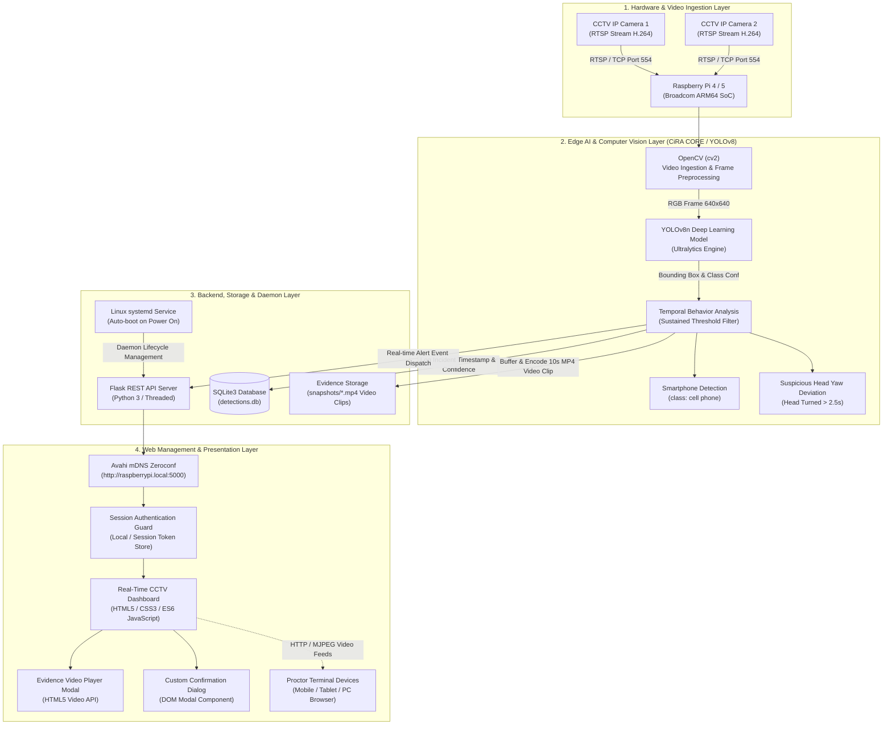
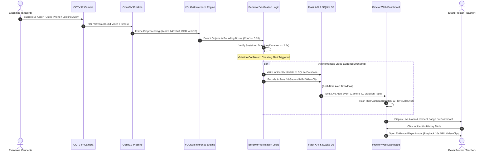
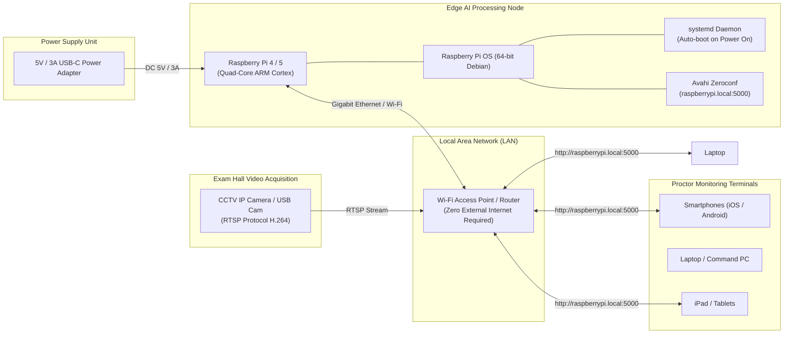
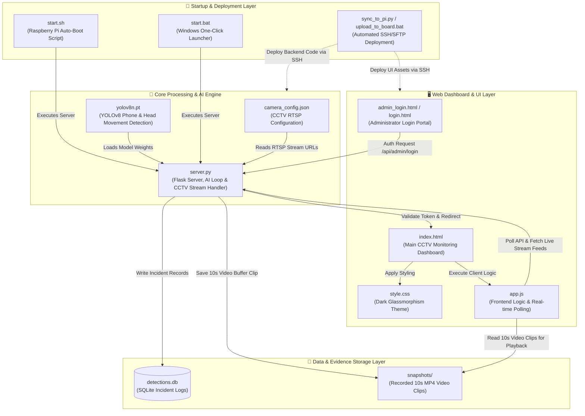

# 📊 Smart AI Exam Integrity CCTV Dashboard — Technical Diagrams
### CPE-447 Project: CiRA CORE & AI Edge Computing Architecture

Clean technical diagrams focused strictly on active features: **Smartphone Detection**, **Suspicious Head Movement (>2.5s)**, and **10-Second MP4 Video Evidence Clips**.

---

## 1. System Architecture Diagram

---

## 2. Sequence Diagram: AI Incident Detection & Proctor Alerting Flow

---

## 3. Hardware & Network Deployment Diagram (Edge AI Plug-and-Play)

---

## 4. Project File Architecture & Component Interaction Diagram

