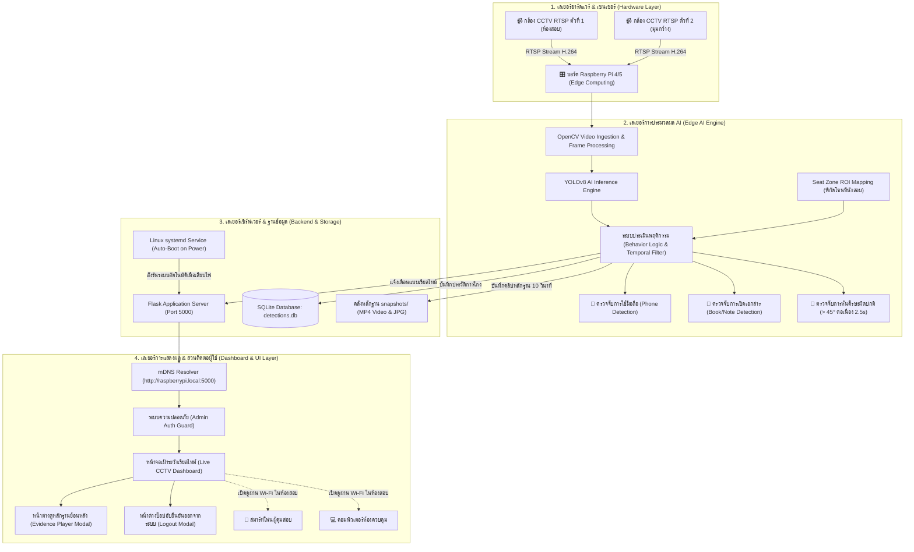
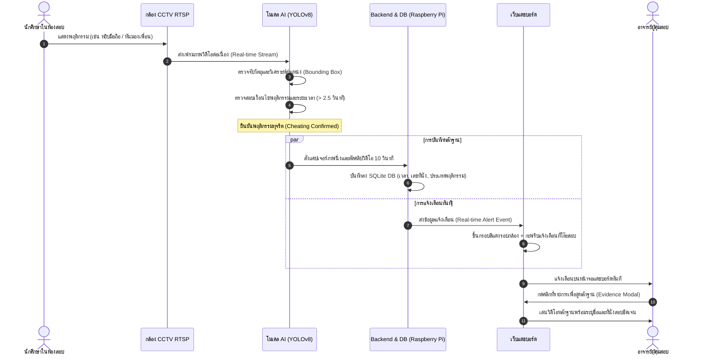
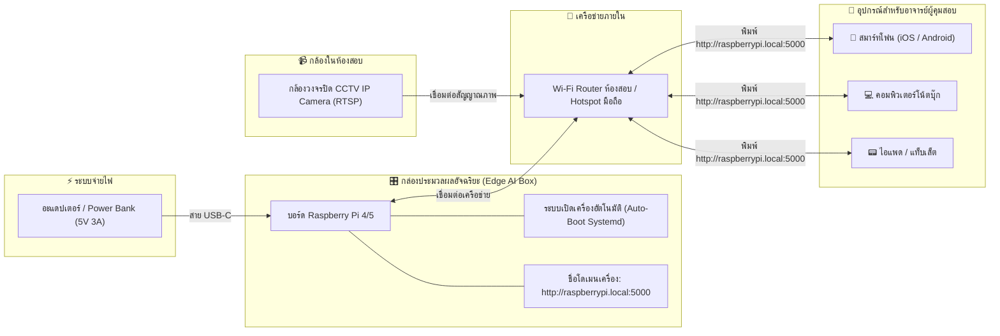

# 📊 แผนภาพระบบ Smart AI Exam Integrity CCTV Dashboard
### CPE-447 Project: CiRA CORE & AI Edge Computing

เอกสารนี้รวบรวมไดอะแกรมสำคัญ 3 รูปแบบ สำหรับนำไปใช้งานใน **สไลด์พรีเซนเทชัน (PowerPoint / Canva)** และ **เล่มรายงานโครงงาน (Project Report)**

---

## 1. System Architecture Diagram (สถาปัตยกรรมระบบโดยรวม)
แผนภาพแสดงโครงสร้างการทำงานทั้ง 4 เลเยอร์ ตั้งแต่การรับสัญญาณภาพ AI ตรวจจับ ฐานข้อมูล จนถึงแดชบอร์ดแสดงผล

---

## 2. Sequence Diagram (ขั้นตอนการทำงานเมื่อ AI ตรวจพบการโกง)
แสดงลำดับการส่งข้อมูลแบบเรียลไทม์ ตั้งแต่นักศึกษามีพฤติกรรมต้องสงสัย จนถึงอาจารย์เปิดดูคลิปหลักฐาน

---

## 3. Deployment & Plug-and-Play Diagram (ผังการเชื่อมต่อติดตั้งจริง)
แสดงการเชื่อมต่อแบบ Standalone Box โดยมี Raspberry Pi เป็นศูนย์กลาง เสียบไฟแล้วใช้งานได้ทันที

---

### 💡 คำแนะนำสำหรับการนำไปใช้พรีเซนต์:
1. **ภาพที่ 1 (System Architecture):** เหมาะสำหรับสไลด์ที่อธิบาย **ภาพรวมโครงสร้างระบบ (System Overview / Methodology)** แสดงความครอบคลุมทั้งฮาร์ดแวร์และซอฟต์แวร์
2. **ภาพที่ 2 (Sequence Diagram):** เหมาะสำหรับอธิบาย **ขั้นตอนการทำงานของ AI (AI Processing & Verification Flow)** แสดงให้เห็นว่าระบบบันทึกหลักฐานได้อย่างแม่นยำอย่างไร
3. **ภาพที่ 3 (Deployment Diagram):** เหมาะสำหรับสไลด์ **การนำไปใช้งานจริง (Implementation & Demo)** เพื่อเน้นย้ำจุดเด่นที่เป็นระบบ Plug & Play เสียบปลั๊กปุ๊บ ใช้งานได้ทันที
